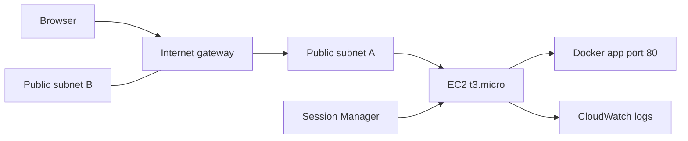

# aws-vpc-health

A small AWS stack I can walk through: Terraform builds a VPC, one EC2 instance runs this HTTP app in Docker, and GitHub Actions tests the app, builds the image, and validates the Terraform on every push.

Use a personal sandbox account. Do not point this at an employer account.

## Cost

A public IPv4 address is billed per hour, including on the AWS free tier. A `t3.micro` is free only inside the 12-month free tier, and the 30 GB encrypted root volume is not free. Left running, this is real money every day.

```bash
cd infra
terraform destroy
```

## Architecture



Two public subnets, one internet gateway, no NAT. The instance sits in the first subnet and reaches the internet through the gateway to install Docker and pull `node:22-alpine`. The second subnet is unused so the VPC is already shaped for a load balancer later, without paying for one now.

Port 80 is the only open port. There is no SSH. The instance role allows Session Manager and writing to one log group. Instance metadata requires IMDSv2, with a hop limit of 2 so the process inside the container can read its instance id.

`GET /health` returns `{"status":"ok"}`. `GET /` returns the service name and, on EC2, the instance id and availability zone.

## Layout

- `app/` is the Node server, its test, and the Dockerfile.
- `infra/` is the VPC, security group, instance, log group, and instance role.
- `.github/workflows/ci.yml` runs on every push. Plan, apply, and destroy run only when you start them by hand, and only after a remote state bucket exists.

## Checks you can run with no AWS account

```bash
npm --prefix app test
docker build -t vpc-health:local app
```

Terraform, from `infra/` after you install the CLI:

```bash
terraform fmt -check -recursive
terraform init -backend=false
terraform validate
```

## Apply it yourself

From `infra/`, with credentials for a sandbox account:

```bash
cp terraform.tfvars.example terraform.tfvars
# Put your public IP /32 in allowed_http_cidrs if it will stay up.
terraform init
terraform apply
```

The first boot installs Docker and builds the image on the instance. Give it a few minutes, then:

```bash
curl "$(terraform output -raw health_url)"
```

A shell on the box, after the [Session Manager plugin](https://docs.aws.amazon.com/systems-manager/latest/userguide/session-manager-working-with-install-plugin.html) is installed:

```bash
aws ssm start-session --target "$(terraform output -raw instance_id)" --region ap-south-1
```

Cloud-init output is `/var/log/cloud-init-output.log`. Container logs are in CloudWatch at `/vpc-health/app` when the awslogs driver starts. If that driver is unavailable, the instance still runs the container and keeps logs locally.

State stays in `infra/terraform.tfstate` on your machine. That file is gitignored. Destroy the stack when you are done looking.

## GitHub Actions

Every push and pull request runs tests, `docker build`, `terraform fmt -check`, and `terraform validate`. That job needs no AWS credentials.

Plan, apply, and destroy are a separate job you start from the Actions tab. It assumes a role with GitHub OIDC and stores state in S3, so a later run can still see the resources. Local state and CI state are not the same. Use one of them for a given stack, not both.

1. Create a versioned S3 bucket in `ap-south-1` for state. This repo does not create that bucket.
2. In IAM, add the GitHub OIDC provider `https://token.actions.githubusercontent.com` with audience `sts.amazonaws.com` if the account does not already have it.
3. Create a role. Use `infra/policies/github-oidc-trust.json` as the trust policy after you replace `ACCOUNT_ID`. Use `infra/policies/github-actions.json` as the permissions policy after you replace `REPLACE_WITH_STATE_BUCKET`.
4. On this GitHub repo, add variables `AWS_ROLE_ARN` and `TF_STATE_BUCKET`.
5. Run the workflow with the **plan** action. Apply and destroy are on the same menu.

The trust policy allows only the `main` branch of `promiseer/aws-vpc-health`. The permissions policy is still broad on EC2 describe and on network changes. Keep it on a sandbox account.

## What I would add next

Private subnets, a NAT gateway or VPC endpoints, an application load balancer across both subnets, and a pipeline that pushes this image to ECR instead of building it on the instance. Remote state would move from "optional CI path" to the default once this is more than a demo.
